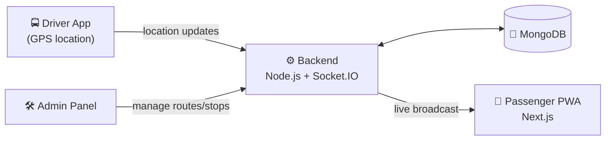

<div align="center">

# 🚌 Smart Public Transit Tracking System

### Real-time bus tracking for the people of Faisalabad

A Progressive Web App (PWA) that shows live vehicle locations, routes and arrival estimates, so commuters spend less time waiting and more time getting where they need to go.

[](https://smart-public-transit-tracking-syste.vercel.app)


**Final Year Project, Department of Software Engineering, NUML Faisalabad Campus**

[Live Demo](https://smart-public-transit-tracking-syste.vercel.app) · [Report a Bug](../../issues) · [Request a Feature](../../issues)

</div>

---

## 📑 Table of Contents

- [About the Project](#-about-the-project)
- [The Problem](#-the-problem)
- [Key Features](#-key-features)
- [Tech Stack](#-tech-stack)
- [System Architecture](#-system-architecture)
- [Project Structure](#-project-structure)
- [Getting Started](#-getting-started)
- [Environment Variables](#-environment-variables)
- [Real-Time Events](#-real-time-events)
- [Deployment](#-deployment)
- [Roadmap](#-roadmap)
- [Contributing](#-contributing)
- [Team](#-team)
- [License](#-license)
- [Acknowledgements](#-acknowledgements)

---

## 📖 About the Project

**Smart Public Transit Tracking System** is a real-time public transport tracking platform built for **Faisalabad**. Vehicles broadcast their live GPS position to the server, and the server pushes updates instantly to every connected passenger over WebSockets (Socket.IO). Passengers see buses moving on a live map, with no refresh needed.

Because it is a **PWA**, it installs on any phone straight from the browser, works like a native app, and needs no app store download.

## ❓ The Problem

Commuters in many cities, Faisalabad included, have no reliable way to know:

- Where the bus is right now
- When it will reach their stop
- Which route to take

This leads to long, uncertain waits, poor planning and low trust in public transport. This project closes that information gap with live data.

## ✨ Key Features

| Feature | Description |
| --- | --- |
| 📍 **Live Vehicle Tracking** | Watch buses move on the map in real time via WebSockets |
| 🗺️ **Route & Stop Information** | Browse routes, stops and vehicles in one place |
| ⏱️ **Arrival Estimates** | Know roughly when the next bus will reach your stop |
| 📱 **Installable PWA** | Add to home screen; responsive on mobile, tablet and desktop |
| 🚍 **Driver Mode** | Drivers share their live location from a phone |
| 🛠️ **Admin Panel** | Manage routes, stops, vehicles and users |
| ⚡ **Low Latency Updates** | Socket.IO pushes changes the moment they happen |

> 🔧 **Note:** Adjust this table to match exactly what is implemented in the project.

## 🧰 Tech Stack

**Frontend**
- [Next.js](https://nextjs.org/) (React framework)
- PWA support (service worker + web manifest)
- Socket.IO Client

**Backend**
- Node.js
- Socket.IO (real-time communication)
- REST API

**Database**
- MongoDB

**Hosting**
- Frontend on [Vercel](https://vercel.com)
- Backend on _(add your host, e.g. Render / Railway / VPS)_

## 🏗️ System Architecture



**How it works**

1. A driver starts a trip and the device shares its GPS coordinates.
2. The backend receives each update over Socket.IO and stores the latest position in MongoDB.
3. The server broadcasts the new position to all passengers subscribed to that route.
4. The passenger's map updates instantly.

## 📂 Project Structure

```
Smart-Public-Transit-Tracking-System/
├── backend/        # Node.js server, REST API, Socket.IO, MongoDB models
└── frontend/       # Next.js PWA (passenger, driver and admin interfaces)
```

## 🚀 Getting Started

### Prerequisites

- [Node.js](https://nodejs.org/) v18 or later
- [MongoDB](https://www.mongodb.com/) (local install or a free [MongoDB Atlas](https://www.mongodb.com/atlas) cluster)
- npm or yarn
- Git

### 1. Clone the repository

```bash
git clone https://github.com/hussnain-stack14/Smart-Public-Transit-Tracking-System.git
cd Smart-Public-Transit-Tracking-System
```

### 2. Set up the backend

```bash
cd backend
npm install
cp .env.example .env     # then fill in your values
npm run dev
```

The backend runs on `http://localhost:5000` by default.

### 3. Set up the frontend

Open a new terminal:

```bash
cd frontend
npm install
cp .env.example .env.local   # then fill in your values
npm run dev
```

The app runs on `http://localhost:3000`.

> 🔧 Check the `scripts` section of each `package.json` and adjust the commands above if your script names differ.

## 🔐 Environment Variables

**`backend/.env`**

```env
PORT=5000
MONGODB_URI=mongodb://localhost:27017/transit-tracker
JWT_SECRET=your_secret_key
CLIENT_URL=http://localhost:3000
```

**`frontend/.env.local`**

```env
NEXT_PUBLIC_API_URL=http://localhost:5000
NEXT_PUBLIC_SOCKET_URL=http://localhost:5000
```

> ⚠️ **Never commit real `.env` files.** Make sure they are listed in `.gitignore`.

## 🔌 Real-Time Events

Example Socket.IO event flow (update names to match your code):

| Event | Direction | Purpose |
| --- | --- | --- |
| `driver:location` | Driver → Server | Driver sends current GPS coordinates |
| `bus:update` | Server → Passengers | Broadcasts the updated bus position |
| `route:subscribe` | Passenger → Server | Passenger starts following a route |
| `route:unsubscribe` | Passenger → Server | Passenger stops following a route |

## ☁️ Deployment

- **Frontend:** push to GitHub and import the `frontend` folder in [Vercel](https://vercel.com). Set the environment variables in the Vercel dashboard.
- **Backend:** deploy the `backend` folder to any Node.js host (Render, Railway, a VPS, etc.). Make sure the host supports **persistent WebSocket connections**; serverless platforms generally do not.
- **Database:** use MongoDB Atlas and put its connection string in `MONGODB_URI`.

🌐 **Live app:** https://smart-public-transit-tracking-syste.vercel.app

## 🗺️ Roadmap

- [x] Real-time vehicle tracking
- [x] Installable PWA
- [ ] Accurate ETA prediction using historical trip data
- [ ] Push notifications ("Your bus is 5 minutes away")
- [ ] Urdu language support
- [ ] Native Android app
- [ ] Offline route and timetable caching
- [ ] Analytics dashboard for transit authorities
- [ ] Crowd level / seat availability reporting

## 🤝 Contributing

Contributions, issues and feature requests are welcome!

1. Fork the project
2. Create your feature branch: `git checkout -b feature/amazing-feature`
3. Commit your changes: `git commit -m "Add amazing feature"`
4. Push to the branch: `git push origin feature/amazing-feature`
5. Open a Pull Request

## 👥 Team

| Name | Role | GitHub |
| --- | --- | --- |
| **Hussnain** | _Your role_ | [@hussnain-stack14](https://github.com/hussnain-stack14) |
| _Teammate name_ | _Role_ | [@username](https://github.com/username) |
| _Teammate name_ | _Role_ | [@username](https://github.com/username) |

**Supervisor:** _Add supervisor name_
**Institution:** National University of Modern Languages (NUML), Faisalabad Campus

## 📄 License

Distributed under the MIT License. See [`LICENSE`](LICENSE) for details.

## 🙏 Acknowledgements

- [Next.js](https://nextjs.org/) · [Socket.IO](https://socket.io/) · [MongoDB](https://www.mongodb.com/)
- Our project supervisor and the faculty of NUML Faisalabad
- Everyone in Faisalabad who commutes daily and inspired this project

---

<div align="center">

⭐ If you found this project useful, please consider giving it a star!

</div>
